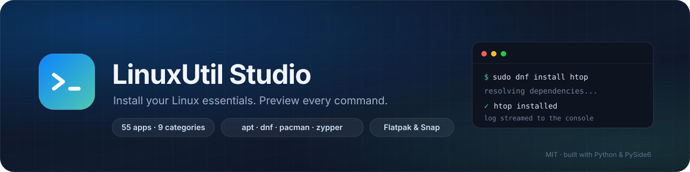
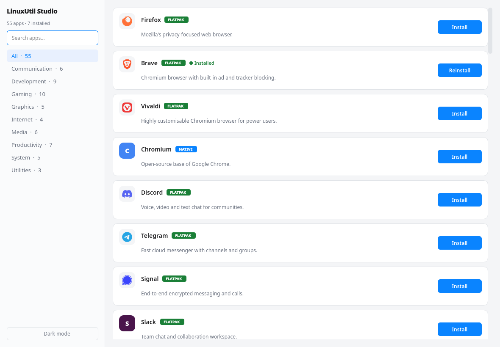
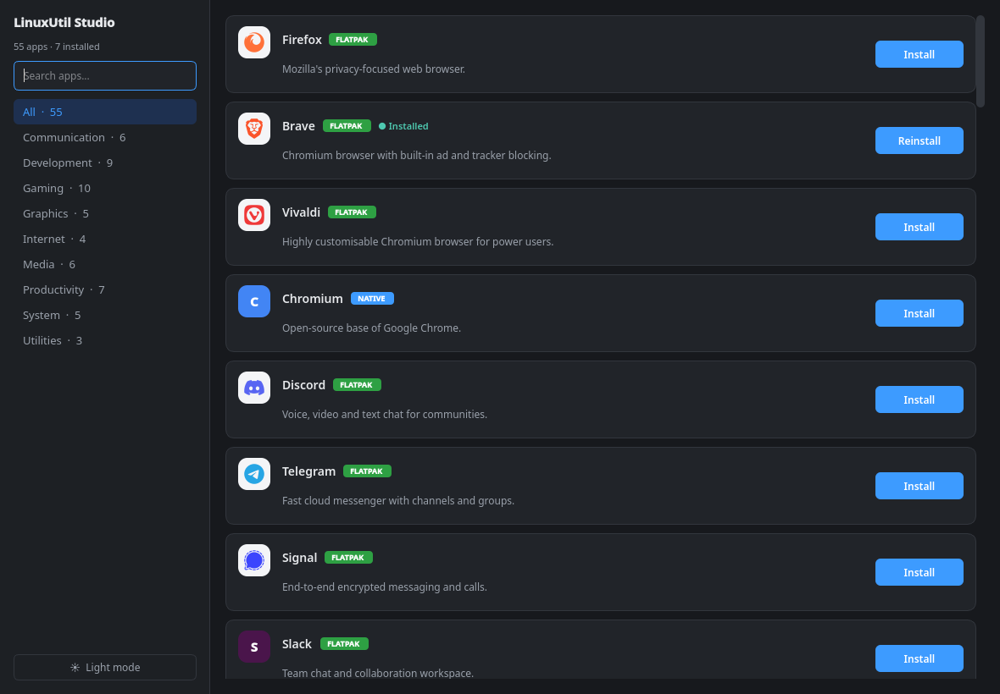
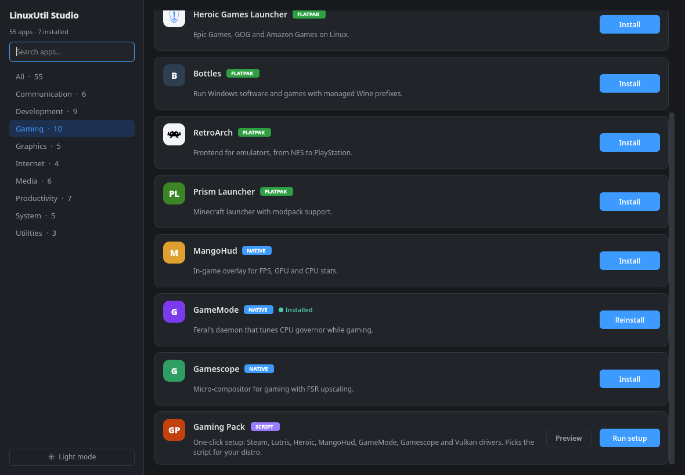
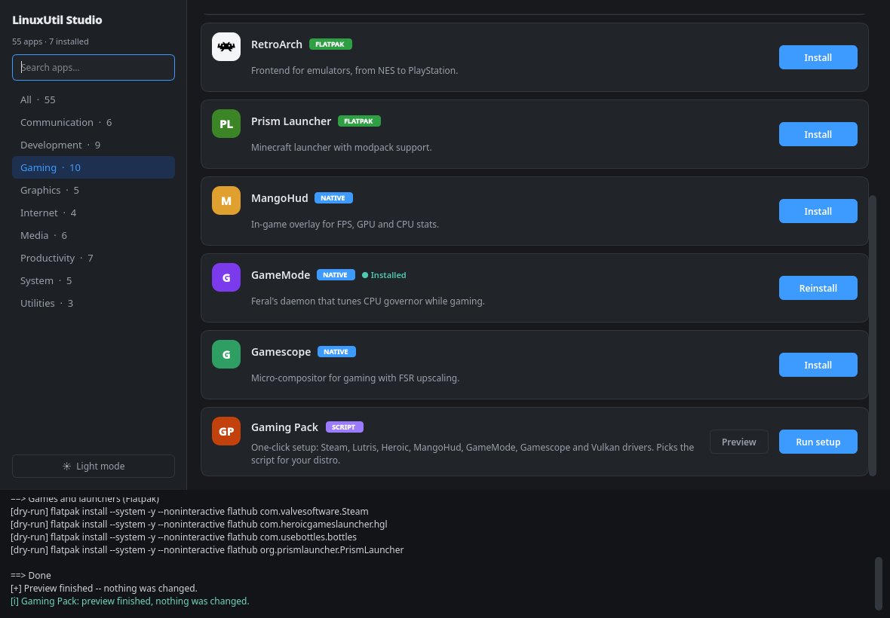
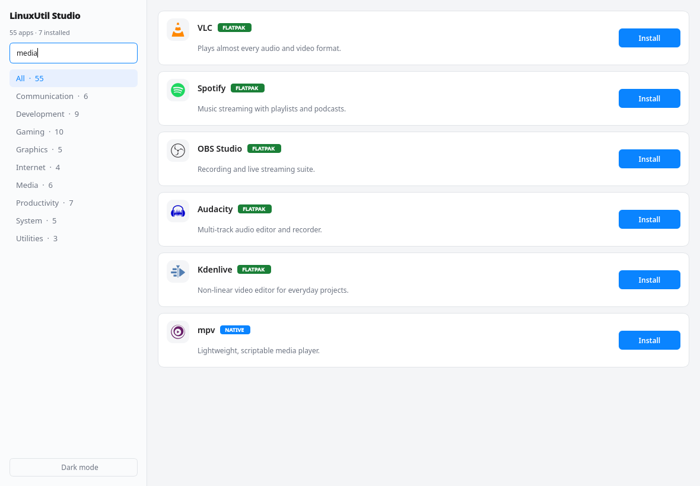
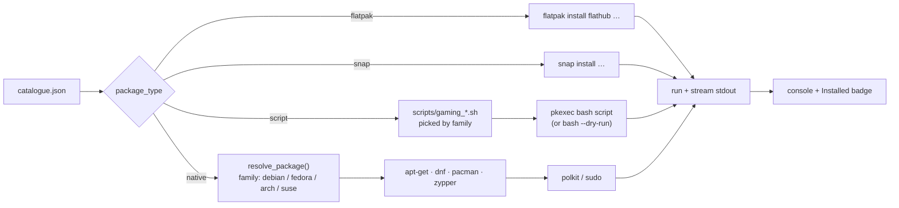

<div align="center">
  
</div>

<br>

<div align="center">

[](https://www.python.org)
[](https://pypi.org/project/PySide6/)
[](#supported-distributions)
[](catalogue.json)
[](LICENSE)

</div>

<h3 align="center">Pick the apps. Watch the install. Keep the receipts.</h3>

<p align="center">
  A native PySide6 app that installs your everyday Linux tools with <b>your</b> package manager —
  and streams every command to a console you can actually read.
</p>

---

| | |
| :--- | :--- |
| **Catalogue** | 55 apps in 9 categories, each with its own package name |
| **Managers** | `apt` · `dnf` · `pacman` · `zypper` · Flatpak · Snap |
| **Gaming** | One-click packs for Fedora, Ubuntu/Debian and Arch/CachyOS |
| **Interface** | Python 3 + PySide6 (Qt 6), light & dark themes, bundled brand logos |
| **Safety** | No shell, no stored passwords, `--dry-run` preview for every setup script |
| **License** | MIT |

## Contents

| | |
| :--- | :--- |
| [Screenshots](#screenshots) | [Command line](#command-line) |
| [Why LinuxUtil Studio](#why-linuxutil-studio) | [The catalogue](#the-catalogue) |
| [Features](#features) | [Gaming packs](#gaming-packs) |
| [Installation](#installation) | [How it works](#how-it-works) |
| [Using the app](#using-the-app) | [Supported distributions](#supported-distributions) |
| [Permissions & security](#permissions--security) | [Project structure](#project-structure) |
| [Development](#development) | [FAQ & troubleshooting](#faq--troubleshooting) |
| [Roadmap](#roadmap) | [Changelog](CHANGELOG.md) |
| [Credits](#credits) | |

## Screenshots

| Light | Dark |
| :---: | :---: |
|  |  |
| *The whole catalogue in one grid.* | *The same window in dark mode.* |

| Gaming category | Preview before installing |
| :---: | :---: |
|  |  |
| *Gaming apps plus the one-click setup pack.* | *`--dry-run` output: every command, zero changes.* |

## Why LinuxUtil Studio

Setting up a new Linux machine is a list of downloads, a handful of `apt` or
`dnf` commands, and a browser tab you forgot to close. LinuxUtil Studio turns
that list into a single window: pick what you want, click **Install**, watch it
happen.

It keeps the logic of **MacUtil** — detect the system, resolve the right
package, run the install, show the log — and rebuilds it as a native Linux app.
No hidden shell scripts for normal apps, no fake progress bars: you see the
exact command that is running and every line it prints.

## Features

**Installing**

- **Native first.** Installs through your distribution's own package manager
  instead of bypassing it, so updates and dependencies stay normal.
- **Per-distro package names.** One catalogue entry, the right package
  everywhere: `libreoffice` / `libreoffice-fresh`, `docker.io` / `moby-engine`,
  `python3` / `python`.
- **Flatpak and Snap** for apps that are only distributed that way, plus native
  Flatpak detection.
- **Installed detection.** Apps already on the system get a green *Installed*
  badge when the window opens.
- **Background installs.** Everything runs off the UI thread, so the window
  never freezes, and output is streamed line by line.
- **Safe failure messages.** `pkexec` cancellations, missing Flatpak and
  unsupported distros get a readable explanation instead of a raw exit code.

**Interface**

- **Light & dark themes**, remembered between runs (`Ctrl+D`).
- **Real brand logos** bundled as SVG, with the desktop icon theme and drawn
  initials as fallbacks.
- **Search and categories** with live counts; searching also matches the
  category name.
- **One console, only when needed.** It stays hidden until the first install,
  then shows colour-coded output.
- **Only the active card says "Working…"** — everything else is simply
  disabled.

**Gaming**

- **Three setup scripts** for Fedora, Ubuntu/Debian and Arch/CachyOS, all
  idempotent and readable.
- **Preview button** that runs them with `--dry-run`: no root, no changes.
- **Steam via Flatpak on purpose**, so the scripts never touch RPM Fusion,
  i386 multiarch or `[multilib]`.

### Choosing installation sources

The catalogue uses distribution packages for tools available in supported
repositories and Flatpak for many desktop applications to keep installation
and updates consistent without silently adding third-party system repositories.
Some vendors provide other official channels; those are not automatically
interchangeable with a tarball or a distro package.

The current 55-entry catalogue has 23 distro-native packages, 29 Flatpaks,
two official-vendor repository installers and one setup script.

Notable source-review findings:

| App | Upstream option | Assessment |
| :--- | :--- | :--- |
| Brave | Vendor-signed repositories for Debian, Fedora and openSUSE; AUR on Arch | Uses the vendor's native package where officially supported. On Arch, uses `brave-bin` via a detected AUR helper; otherwise retains the Flatpak fallback. Brave warns that its Flatpak has Chromium sandbox differences. |
| Visual Studio Code | Official Microsoft `.deb`/RPM repositories and Snap; community AUR on Arch | Uses Microsoft's signed distro repository on Debian/Fedora/openSUSE. On Arch, uses `visual-studio-code-bin` via a detected AUR helper; otherwise retains the Flathub fallback. |
| Obsidian | Official AppImage, Snap and `.deb`; community-maintained Flatpak | The official site labels the Flatpak community-maintained. AppImage avoids adding a repository but needs separate update handling. |
| Slack | Official RPM download and Snap | A native/vendor route is available, but needs per-distro handling; one Flatpak target remains simpler across the supported families. |
| DBeaver | Official Debian repository and Flatpak | The upstream download page supports both; Flatpak is not inherently a worse choice here. |
| Joplin | Official AppImage and install/update script | The script is upstream-recommended but executes downloaded code; it should not be adopted without a reviewable, verified update/install flow. |

Vendor installs require confirmation and a preview is available first. APT
signing keys are checked against pinned fingerprints; RPM packages are
signature-checked by the package manager. Removal deletes only repository/key
files created by LinuxUtil Studio; pre-existing repo files are left untouched.
Sources: [Brave's Linux install guide](https://brave.com/linux/),
Microsoft's [VS Code Linux guide](https://code.visualstudio.com/docs/setup/linux),
the [VS Code Flathub manifest](https://github.com/flathub/com.visualstudio.code/blob/master/com.visualstudio.code.yaml),
the [Obsidian download page](https://obsidian.md/download),
[Slack downloads](https://slack.com/downloads/linux),
[DBeaver downloads](https://dbeaver.io/download/), and
[Joplin installation guide](https://joplinapp.org/help/install/).

## Installation

Pick whichever method suits you best. All of them end up launching the same
application.

### Option 0 — One command, straight from the repo

No binary release download required. Clone and install in one line:

```bash
git clone --depth 1 https://github.com/desorderrr/LinuxUtil-Studio.git ~/LinuxUtil-Studio && bash ~/LinuxUtil-Studio/install.sh
```

### Option 1 — One-line installer (recommended)

Downloads nothing extra; just uses the repo you already cloned:

```bash
git clone https://github.com/desorderrr/LinuxUtil-Studio.git
cd LinuxUtil-Studio
bash install.sh
```

`install.sh` copies the project to `~/.local/share/linuxutil-studio`, creates a
virtualenv, installs PySide6, and drops a `LinuxUtil Studio` shortcut in your
application menu. Works regardless of your current working directory.

### Option 2 — AppImage

Download the AppImage from the
[v1.0.0 release](https://github.com/desorderrr/LinuxUtil-Studio/releases/download/v1.0.0/LinuxUtil_Studio-x86_64.AppImage):

```bash
chmod +x LinuxUtil_Studio-x86_64.AppImage
./LinuxUtil_Studio-x86_64.AppImage
```

This binary is from the initial release; use the source installer for the
latest changes.

### Option 3 — Flatpak (experimental)

> **Experimental.** The Flatpak runs the UI inside the sandbox but delegates
> package installation to the host through `flatpak-spawn --host`. It is
> functional on Fedora and Arch, but not yet validated on every desktop, so
> prefer the source installer for daily use.

Download `linuxutil-studio.flatpak` from the
[latest release](https://github.com/desorderrr/LinuxUtil-Studio/releases/latest),
then install it:

```bash
flatpak install --user ./linuxutil-studio.flatpak
flatpak run com.linuxutilstudio.Studio
```

To build it locally (downloads the PySide6 wheels before building):

```bash
bash flatpak/build.sh
```

Tagged releases publish the Flatpak bundle and its `SHA256SUMS` file
automatically.

Requirements: `flatpak-builder` and `org.freedesktop.Sdk//25.08`.
The Flatpak remains experimental; see the caveat above before using it.

### Option 4 — From source

```bash
git clone https://github.com/desorderrr/LinuxUtil-Studio.git
cd LinuxUtil-Studio

python3 -m venv .venv
source .venv/bin/activate
pip install -r requirements.txt

python3 main.py
```

**Requirements**

- Python **3.10+** and a desktop session (X11 or Wayland).
- One native manager: `apt`, `dnf`, `pacman` or `zypper`.
- Optional: `flatpak` and/or `snap` for the apps distributed that way.
- `polkit` (`pkexec`) for the graphical password prompt — present on virtually
  every desktop distribution.

> **Why a virtualenv?** Several distributions (Fedora, recent Debian/Ubuntu)
> mark the system Python as externally managed, so `pip install --user` can
> refuse to run. A venv is one command and keeps PySide6 out of the system.

The app needs **no root to start** — only the package manager asks for your
password, through the desktop's own polkit dialog.

## Using the app

1. **Browse or search.** Use the sidebar categories or type in the search box;
   both filter instantly.
2. **Click Install.** The card shows *Working…*, the console slides up and the
   log streams live.
3. **Authenticate.** Your desktop shows its standard password dialog (polkit).
   The app never sees or stores the password.
4. **Done.** The card turns into *Reinstall* and gets the *Installed* badge.

Use **Cancel installation** to stop the active command if needed. Package
changes completed before cancellation are not rolled back.
Installed individual apps also show **Remove**. Removal is confirmed first,
does not purge Flatpak user data or unused dependencies, and is unavailable for
the Gaming Pack because its script installs shared system packages.

| Shortcut | Action |
| :--- | :--- |
| `Ctrl+D` | Toggle light / dark theme |
| Search box | Filter by name, description or category |
| Category list | Show a single category |



## Command line

The backend works without a GUI, which is handy over SSH or in scripts:

```bash
python3 main.py --info                            # distro, manager, family, Flatpak/Snap, privilege tool
python3 main.py --list                            # catalogue + resolved target + installed state
python3 main.py --install spotify                 # install an app by its catalogue ID
python3 main.py --remove spotify                  # remove an installed app by catalogue ID
python3 main.py --install gaming-pack --dry-run   # print what a setup script would do
python3 main.py --cli                             # interactive mode
```

`--list` resolves the package name for **your** distribution, so it doubles as
a quick check of what would be installed:

```text
ID             TYPE      TARGET                             STATUS     NAME
------------------------------------------------------------------------------------------
git            native    git                                installed  Git (Development)
docker         native    moby-engine                        -          Docker Engine (Development)
steam          flatpak   com.valvesoftware.Steam            -          Steam (Gaming)
gaming-pack    script    gaming_fedora.sh                   -          Gaming Pack (Gaming)
```

## The catalogue

Apps live in [`catalogue.json`](catalogue.json). Adding one is a single object:

```json
{
    "id": "libreoffice",
    "name": "LibreOffice",
    "description": "Office suite: documents, spreadsheets and slides.",
    "category": "Productivity",
    "package_type": "native",
    "package_name": "libreoffice",
    "packages": {"arch": "libreoffice-fresh"}
}
```

| Field | Required | Meaning |
| :--- | :---: | :--- |
| `id` | yes | Stable identifier. Also the logo filename: `assets/logos/<id>.svg`. |
| `name` | yes | Label shown on the card. |
| `description` | yes | One line under the name. |
| `category` | yes | One of the nine categories in the sidebar. |
| `package_type` | yes | `native`, `flatpak`, `snap`, `script` or `vendor`. |
| `package_name` | yes | Name used by the underlying manager. |
| `packages` | no | Per-family override: `debian`, `fedora`, `arch`, `suse`. |
| `fallback_type` | vendor only | Package type used where a supported vendor repository is unavailable. |
| `fallback_package_name` | vendor only | Package ID for the fallback type. |
| `icon` | no | Freedesktop icon name, tried after the bundled logo. |
| `scripts` | for `script` | Maps a family to a file in `scripts/`. |
| `check` | for `script` | Packages that prove the pack is already applied. |

### 55 apps, 9 categories

| Category | Apps | Highlights |
| :--- | :---: | :--- |
| Internet | 4 | Firefox, Brave, Vivaldi, Chromium |
| Communication | 6 | Discord, Telegram, Signal, Slack, Zoom, Element |
| Development | 9 | Git, Neovim, VS Code, Python, Node.js, Docker, Postman, DBeaver, Godot |
| Gaming | 10 | Steam, Lutris, Heroic, Bottles, RetroArch, Prism, MangoHud, GameMode, Gamescope + the pack |
| Media | 6 | VLC, Spotify, OBS Studio, Audacity, Kdenlive, mpv |
| Graphics | 5 | GIMP, Inkscape, Krita, Blender, darktable |
| Productivity | 7 | LibreOffice, Thunderbird, Obsidian, ONLYOFFICE, Joplin, Bitwarden, KeePassXC |
| System | 5 | htop, btop, GParted, Timeshift, Flatseal |
| Utilities | 3 | cURL, Wget, Unzip |

<details>
<summary><b>Internet</b> — 4 apps</summary>

| App | Format | Package / target | What it does |
| :--- | :---: | :--- | :--- |
| **Firefox** | Flatpak | `org.mozilla.firefox` | Mozilla's privacy-focused web browser. |
| **Brave** | Vendor / Flatpak fallback | `brave-browser` / `com.brave.Browser` | Chromium browser with built-in ad and tracker blocking. |
| **Vivaldi** | Flatpak | `com.vivaldi.Vivaldi` | Highly customisable Chromium browser for power users. |
| **Chromium** | Native | `chromium` | Open-source base of Google Chrome. |

</details>

<details>
<summary><b>Communication</b> — 6 apps</summary>

| App | Format | Package / target | What it does |
| :--- | :---: | :--- | :--- |
| **Discord** | Flatpak | `com.discordapp.Discord` | Voice, video and text chat for communities. |
| **Telegram** | Flatpak | `org.telegram.desktop` | Fast cloud messenger with channels and groups. |
| **Signal** | Flatpak | `org.signal.Signal` | End-to-end encrypted messaging and calls. |
| **Slack** | Flatpak | `com.slack.Slack` | Team chat and collaboration workspace. |
| **Zoom** | Flatpak | `us.zoom.Zoom` | Video meetings and webinars. |
| **Element** | Flatpak | `im.riot.Riot` | Matrix client for decentralised, encrypted chat. |

</details>

<details>
<summary><b>Development</b> — 9 apps</summary>

| App | Format | Package / target | What it does |
| :--- | :---: | :--- | :--- |
| **Git** | Native | `git` | Distributed version control system. |
| **Neovim** | Native | `neovim` | Extensible Vim-based text editor. |
| **Visual Studio Code** | Vendor / Flatpak fallback | `code` / `com.visualstudio.code` | Code editor with debugging and Git integration. |
| **Python 3** | Native | `python3` <br><sub>Arch: python</sub> | High-level programming language interpreter. |
| **Node.js** | Native | `nodejs` | JavaScript runtime for servers and tooling. |
| **Docker Engine** | Native | `docker` <br><sub>Fedora: moby-engine · Debian: docker.io</sub> | Containers for building and running applications. |
| **Postman** | Flatpak | `com.getpostman.Postman` | Design, test and document APIs. |
| **DBeaver** | Flatpak | `io.dbeaver.DBeaverCommunity` | Universal database client for SQL and NoSQL. |
| **Godot Engine** | Flatpak | `org.godotengine.Godot` | Open-source 2D and 3D game engine. |

</details>

<details>
<summary><b>Gaming</b> — 10 apps</summary>

| App | Format | Package / target | What it does |
| :--- | :---: | :--- | :--- |
| **Steam** | Flatpak | `com.valvesoftware.Steam` | Valve's game store and launcher. |
| **Lutris** | Native | `lutris` | Game manager for Linux, Wine, emulators and launchers. |
| **Heroic Games Launcher** | Flatpak | `com.heroicgameslauncher.hgl` | Epic Games, GOG and Amazon Games on Linux. |
| **Bottles** | Flatpak | `com.usebottles.bottles` | Run Windows software and games with managed Wine prefixes. |
| **RetroArch** | Flatpak | `org.libretro.RetroArch` | Frontend for emulators, from NES to PlayStation. |
| **Prism Launcher** | Flatpak | `org.prismlauncher.PrismLauncher` | Minecraft launcher with modpack support. |
| **MangoHud** | Native | `mangohud` | In-game overlay for FPS, GPU and CPU stats. |
| **GameMode** | Native | `gamemode` | Feral's daemon that tunes CPU governor while gaming. |
| **Gamescope** | Native | `gamescope` | Micro-compositor for gaming with FSR upscaling. |
| **Gaming Pack** | Script | `scripts/*.sh` <br><sub>Fedora · Debian · Arch</sub> | One-click setup: Steam, Lutris, Heroic, MangoHud, GameMode, Gamescope and Vulkan drivers. Picks the script for your distro. |

</details>

<details>
<summary><b>Media</b> — 6 apps</summary>

| App | Format | Package / target | What it does |
| :--- | :---: | :--- | :--- |
| **VLC** | Flatpak | `org.videolan.VLC` | Plays almost every audio and video format. |
| **Spotify** | Flatpak | `com.spotify.Client` | Music streaming with playlists and podcasts. |
| **OBS Studio** | Flatpak | `com.obsproject.Studio` | Recording and live streaming suite. |
| **Audacity** | Flatpak | `org.audacityteam.Audacity` | Multi-track audio editor and recorder. |
| **Kdenlive** | Flatpak | `org.kde.kdenlive` | Non-linear video editor for everyday projects. |
| **mpv** | Native | `mpv` | Lightweight, scriptable media player. |

</details>

<details>
<summary><b>Graphics</b> — 5 apps</summary>

| App | Format | Package / target | What it does |
| :--- | :---: | :--- | :--- |
| **GIMP** | Native | `gimp` | Image editor for photo retouching and design. |
| **Inkscape** | Native | `inkscape` | Vector graphics editor for SVG illustration. |
| **Krita** | Flatpak | `org.kde.krita` | Digital painting studio for illustrators. |
| **Blender** | Flatpak | `org.blender.Blender` | 3D modelling, animation and rendering suite. |
| **darktable** | Flatpak | `org.darktable.Darktable` | RAW photo workflow and non-destructive editing. |

</details>

<details>
<summary><b>Productivity</b> — 7 apps</summary>

| App | Format | Package / target | What it does |
| :--- | :---: | :--- | :--- |
| **LibreOffice** | Native | `libreoffice` <br><sub>Arch: libreoffice-fresh</sub> | Office suite: documents, spreadsheets and slides. |
| **Thunderbird** | Native | `thunderbird` | Email, calendar and newsgroups client. |
| **Obsidian** | Flatpak | `md.obsidian.Obsidian` | Markdown knowledge base with linked notes. |
| **ONLYOFFICE** | Flatpak | `org.onlyoffice.desktopeditors` | Office suite with strong Microsoft format support. |
| **Joplin** | Flatpak | `net.cozic.joplin_desktop` | Encrypted note taking with sync and Markdown. |
| **Bitwarden** | Flatpak | `com.bitwarden.desktop` | Open-source password manager. |
| **KeePassXC** | Native | `keepassxc` | Offline password manager with local database. |

</details>

<details>
<summary><b>System</b> — 5 apps</summary>

| App | Format | Package / target | What it does |
| :--- | :---: | :--- | :--- |
| **htop** | Native | `htop` | Interactive process viewer for the terminal. |
| **btop** | Native | `btop` | Resource monitor with graphs for CPU, memory and disk. |
| **GParted** | Native | `gparted` | Graphical partition editor. |
| **Timeshift** | Native | `timeshift` | System snapshots for instant rollback. |
| **Flatseal** | Flatpak | `com.github.tchx84.Flatseal` | Manage permissions of your Flatpak apps. |

</details>

<details>
<summary><b>Utilities</b> — 3 apps</summary>

| App | Format | Package / target | What it does |
| :--- | :---: | :--- | :--- |
| **cURL** | Native | `curl` | Command-line tool for transferring data with URLs. |
| **Wget** | Native | `wget` | Retrieves files from the web via HTTP, HTTPS and FTP. |
| **Unzip** | Native | `unzip` | Extracts .zip archives from the command line. |

</details>

## Gaming packs

`scripts/` holds one setup script per family. They are plain bash — open them,
read them, run them by hand if you prefer.

| Script | Distro family |
| :--- | :--- |
| [`gaming_fedora.sh`](scripts/gaming_fedora.sh) | Fedora, Nobara, RHEL, Rocky, AlmaLinux |
| [`gaming_debian.sh`](scripts/gaming_debian.sh) | Ubuntu, Debian, Mint, Pop!_OS, Zorin |
| [`gaming_arch.sh`](scripts/gaming_arch.sh) | Arch, CachyOS, Manjaro, EndeavourOS, Garuda |

**What they install**

| Source | Packages |
| :--- | :--- |
| Native repositories | Lutris, MangoHud, GameMode, Gamescope, Wine + Winetricks, Vulkan tools and drivers |
| Flathub | Steam, Heroic Games Launcher, Bottles, Prism Launcher |

The scripts are **idempotent**: running them twice is fine, and `pacman -S
--needed` / `apt-get install` skip what is already there.

**Preview first.** The app's **Preview** button runs the script with `--dry-run`,
without root and without touching the system:

```bash
bash scripts/gaming_arch.sh --dry-run
python3 main.py --install gaming-pack --dry-run
```

**Design choices**

- **Steam comes from the official Flatpak.** No RPM Fusion, no i386 multiarch
  setup, no `[multilib]` editing. It ships its own runtime and updates itself.
- **Arch and `[multilib]`:** if the repo is disabled, the script skips Wine and
  says why instead of editing `/etc/pacman.conf` behind your back. Bottles
  (Flatpak) still gives you a Wine prefix.
- **Optional packages are allowed to fail.** Older Ubuntu releases have no
  `gamescope`; that is reported as *skipped*, not as a failed setup. The script
  only exits non-zero if Lutris or MangoHud are missing.
- **One password prompt.** The script runs once through `pkexec`, so polkit
  asks for your password once and the package manager runs as root.

> The full pack downloads several GB (Steam runtime, Wine, drivers). Use
> **Preview** first if you only want to see the plan.

## How it works



1. **Detect.** `SystemInfo` reads the distro (`distro` module, with fallbacks),
   picks the manager and derives the family.
2. **Resolve.** `package_name` is overridden by `packages[family]` when present,
   and `script` entries map their family to a file in `scripts/`.
3. **Escalate.** Commands run by the app use `sudo -n true` first: if
   passwordless sudo works, use it. Otherwise, in a graphical session, use
   `pkexec` so polkit owns the password prompt. AUR helpers run as the user and
   use their own configured privilege escalation; the app never builds AUR
   packages as root.
4. **AUR on Arch.** If `yay`, `paru`, `trizen` or `pikaur` is already
   installed, native packages use the first detected helper. Brave and VS Code
   use their AUR packages through that helper; without one, they keep the
   Flatpak fallback. Helpers are never installed automatically. AUR installs
   require confirmation because their community build scripts are not audited
   by LinuxUtil Studio.
5. **Run.** Commands are built as **argv lists** and executed with
   `subprocess.Popen`, merged stdout/stderr, streamed line by line to the UI.
6. **Verify.** Each app has a read-only check (`rpm -q`, `dpkg -s`, `pacman -Q`,
   `flatpak info`, `snap list`) that drives the *Installed* badge.

## Supported distributions

| Family | Manager | Examples |
| :--- | :--- | :--- |
| Debian / Ubuntu | `apt` | Ubuntu, Debian, Mint, Pop!_OS, Zorin, Kali |
| Fedora | `dnf` | Fedora, Nobara, RHEL, Rocky, AlmaLinux |
| Arch | `pacman` | Arch, CachyOS, Manjaro, EndeavourOS, Garuda |
| openSUSE | `zypper` | openSUSE Leap / Tumbleweed |

Native and Flatpak installs work on all four families, and gaming scripts are
available for Fedora, Debian/Ubuntu, Arch and openSUSE. Immutable systems
(Fedora Silverblue/Kinoite, openSUSE MicroOS) need `rpm-ostree` /
`transactional-update` handling and remain on the roadmap.

## Permissions & security

- **No credentials.** The app never reads, stores, logs or transmits passwords.
  Authentication is handed to polkit, the desktop's own mechanism.
- **No shell for normal installs.** Native, Flatpak and Snap commands are argv
  lists passed straight to `exec`, so package names are never interpreted by a
  shell.
- **Shell scripts are opt-in and visible.** The gaming packs are ordinary files
  in `scripts/`; the UI shows a confirmation dialog with the script name and
  offers **Preview** before anything runs.
- **Preview cannot change the system.** `--dry-run` runs without root and only
  prints the planned commands.
- **Read-only detection.** Installed checks only query package metadata.
- **AUR packages are community-maintained.** They are used only when a helper
  is already installed; the app asks before installing one and never installs
  an AUR helper itself. Official repository packages keep using `pacman` through
  `pkexec`, so a GUI session without a terminal still gets a polkit prompt
  instead of a failing `sudo`.
- **Network** is used by the package manager, Flathub and Flatpak — not by the
  app itself.

## Project structure

```text
main.py                     # entry point: GUI + CLI flags
catalogue.json              # 55 apps, 9 categories
requirements.txt            # PySide6

core/
  system_info.py            # distro/manager/family detection, package + script resolution, argv building
  installer.py              # execution, streaming, installed checks, error messages
  catalogue_loader.py       # JSON loading and normalisation

ui/
  main_window.py            # window, cards, workers, console
  theme.py                  # light/dark palettes, QSS, saved preference
  icons.py                  # SVG logo -> icon theme -> generated initials tile

assets/
  banner.svg                # README banner
  logo.svg / logo.png       # project mark used as the app icon
  logos/                    # 39 brand logos (Simple Icons, CC0) + attribution
  screenshots/              # README screenshots

scripts/
  gaming_fedora.sh          # Fedora / Nobara / RHEL
  gaming_debian.sh          # Ubuntu / Debian / Mint / Pop!_OS
  gaming_arch.sh            # Arch / CachyOS / Manjaro / EndeavourOS
  gaming_suse.sh            # openSUSE Leap / Tumbleweed (zypper)
  vendor_apps.sh            # VS Code / Brave official vendor repositories

tests/
  test_catalogue.py         # catalogue, logos, resolution and script dry-run tests
```

## Development

Contributions are welcome — read [`CONTRIBUTING.md`](CONTRIBUTING.md) for the
ground rules, then jump to [adding an app](#add-an-app) or
[adding a gaming pack](CONTRIBUTING.md#adding-a-gaming-pack).

**Run the tests** (no PySide6 needed):

```bash
python3 -m unittest discover -s tests -v
```

They check unique IDs, required fields, known categories and formats, valid
per-family overrides, that every declared script exists, that bundled logos are
real SVGs, that native packages resolve, that commands are argv lists, and that
the gaming script for the current family completes `--dry-run` with exit 0.

The same suite runs in GitHub Actions (`.github/workflows/tests.yml`) on Python
3.10 and 3.12, together with the Python and bash syntax checks.

**Compile check / syntax:**

```bash
python3 -m py_compile main.py core/*.py ui/*.py
for f in scripts/*.sh; do bash -n "$f"; done
```

### Add an app

1. Append an object to `catalogue.json` (see [the catalogue](#the-catalogue)).
2. Drop `assets/logos/<id>.svg` if you have a logo — otherwise the app falls
   back to the icon theme and then to coloured initials.
3. If the package has a different name on another family, add `packages`.
4. Verify: `python3 main.py --list` and `python3 main.py --install <id> --dry-run`
   for script entries.

### Add a distro family

1. Map the distro ID to a manager in `core/system_info.py` (`_get_package_manager`).
2. Add the manager → family pair to `FAMILY_BY_MANAGER`.
3. Add the install/check commands for the new manager in `get_install_commands`
   and `get_check_command`.
4. If you want a gaming pack, add `scripts/gaming_<family>.sh` and map it in
   `catalogue.json`.

## FAQ & troubleshooting

| Symptom | Cause & fix |
| :--- | :--- |
| *"sudo: a terminal is required to read the password"* | The app was started without a terminal and no polkit agent is running. Install/enable a polkit authentication agent (GNOME and KDE ship one) so `pkexec` can show the dialog — or run the app from a terminal. |
| *"X needs Flatpak, which is not installed"* | Install Flatpak first (`sudo dnf install flatpak` / `sudo apt install flatpak`) and add Flathub; the app deliberately does not install a package manager for you. |
| *Preview prints commands but nothing happens* | That is the point of `--dry-run`. Use **Run setup** / **Install** for the real run; it will ask for your password. |
| *Gamescope missing after the Ubuntu pack* | Not packaged in older Ubuntu releases. The pack reports it as skipped and continues. |
| *Steam download is huge* | The Flatpak pulls the Steam runtime and 32-bit graphics drivers. It is a one-time cost and keeps the host clean. |
| *A card says "Reinstall"* | The package was detected on the system. Reinstall is harmless and idempotent. |
| *Gaming pack for openSUSE* | Available since v1.2: `scripts/gaming_suse.sh` (zypper). Reports packages that are not in the configured repositories instead of failing. |
| *Nothing appears / no window on Wayland* | Run from a terminal and check the output; the app needs `WAYLAND_DISPLAY` or `DISPLAY` and a Qt platform plugin. |

## Roadmap

- [x] 55-app catalogue with per-distro package names
- [x] Bundled brand logos with theme-aware tiles
- [x] Gaming packs for Fedora, Ubuntu/Debian, Arch/CachyOS and openSUSE
- [x] `--dry-run` preview for every script
- [x] Desktop entry and app icon, so it launches from the menu
- [x] AUR helper detection on Arch (yay/paru/...) — reported, never auto-installed
- [x] "Updates available" view (read-only listing, `--updates`)
- [x] AUR helper usage on Arch (helpers only for AUR packages; native stays on `pacman` + `pkexec`; helpers are never installed)
- [ ] Immutable systems (`rpm-ostree`, `transactional-update`) — deferred: different flows and risk profile
- [ ] Flatpak/AppImage distribution policy: keep both, or recommend Flatpak + source only

## Verified on

| | |
| :--- | :--- |
| Host | Fedora 44, GNOME on Wayland |
| Manager | `dnf`, Flatpak installed, Snap absent |
| Privilege | `pkexec` (polkit) |
| Checks | 37/37 unit tests, shell syntax checks for all gaming scripts, host-family gaming `--dry-run`, 55/55 resolved install commands, AUR helper routing, `--updates` smoke |
| Live test | `pkexec dnf install -y htop` → polkit prompt → `Complete!` → *Installed* badge; `bash install.sh` from a clean clone |
| AUR path | Simulated yay/paru detection covered by unit tests; live validation on Arch/CachyOS still pending |
| Packaging | Flatpak v1.3.0 (experimental) published with `SHA256SUMS`; AppImage is still the v1.0.0 build |


## Credits

- Brand logos from [Simple Icons](https://simpleicons.org) (**CC0 1.0**), vendored
  in `assets/logos/`. They remain the trademarks of their respective owners and
  are used only to identify the app being installed. See
  [`assets/logos/README.md`](assets/logos/README.md).
- Built with [PySide6](https://doc.qt.io/qtforpython/) / Qt 6.
- Inspired by **MacUtil** — same idea, different kernel.

## License

MIT — see [LICENSE](LICENSE). Do whatever you want, just keep the copyright
notice.
